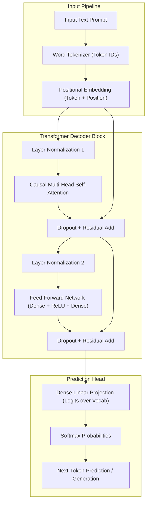

# Development of a Transformer-Based Next-Token Prediction Model Using Self-Attention

[](https://www.python.org/)
[](https://tensorflow.org/)
[](LICENSE)

An end-to-end, educational, and clean implementation of a **decoder-only autoregressive Transformer** built from scratch using **TensorFlow / Keras**. The model is trained on classic literary text (*The Adventures of Sherlock Holmes* from Project Gutenberg) to perform causal next-token prediction using multi-head self-attention mechanisms with causal masking.

---

## 📌 Table of Contents
- [Project Overview](#project-overview)
- [Architecture & Design](#architecture--design)
- [Key Features](#key-features)
- [Pipeline Workflow](#pipeline-workflow)
- [Directory Structure](#directory-structure)
- [Installation & Requirements](#installation--requirements)
- [Usage Guide](#usage-guide)
  - [1. Running the Notebook](#1-running-the-notebook)
  - [2. Interactive Next-Token Prediction](#2-interactive-next-token-prediction)
  - [3. Autoregressive Text Generation](#3-autoregressive-text-generation)
  - [4. Attention Map Visualization](#4-attention-map-visualization)
- [Model Evaluation & Metrics](#model-evaluation--metrics)
- [Limitations & Future Enhancements](#limitations--future-enhancements)
- [Contributing & License](#contributing--license)

---

## 📖 Project Overview

Traditional recurrent architectures (RNNs, LSTMs) process sequence data sequentially, which creates computational bottlenecks and struggles with long-range dependencies. This project demonstrates the core architectural principles behind modern Large Language Models (e.g., GPT series) by building a causal next-token prediction system utilizing:
- **Causal Multi-Head Self-Attention** with triangular attention masks preventing future token leakage.
- **Learned Positional Embeddings** to preserve sequential token order.
- **Feed-Forward Networks & Residual Layer Normalization** to stabilize training.
- **Vocabulary Tokenizer** with special tokens (`<pad>`, `<unk>`, `<eos>`).

---

## 🏗 Architecture & Design

The architecture implements a classic **Decoder-Only Transformer** block tailored for language modeling:



### Architectural Hyperparameters
| Parameter | Default Value | Description |
| :--- | :--- | :--- |
| `MAX_LEN` | `32` | Maximum context window length |
| `EMBED_DIM` | `64` | Token and position embedding dimension |
| `NUM_HEADS` | `2` | Number of parallel self-attention heads |
| `FF_DIM` | `128` | Hidden layer dimension in Feed-Forward network |
| `BATCH_SIZE` | `64` | Training batch size |
| `OPTIMIZER` | Adam (`lr=1e-3`) | Optimization algorithm |
| `LOSS` | Sparse Categorical Crossentropy | Multi-class token prediction loss |

---

## ✨ Key Features

1. **Self-Contained Data Pipeline**:
   - Automated download and cache handling of *The Adventures of Sherlock Holmes* via Project Gutenberg.
   - Text cleaning, punctuation separation, and chronological dataset partitioning (80% Train, 10% Validation, 10% Test) to avoid data leakage.
2. **From-Scratch Layer Implementations**:
   - `PositionalEmbedding`: Combines token embeddings and learnable position vectors.
   - `TransformerDecoderBlock`: Implements causal self-attention, residual connections, and layer normalization.
   - `NextTokenTransformer`: Modular decoder stack outputting raw logits.
3. **Rigorous Technical Validations**:
   - Shape assertions across embeddings, attention heads, and output projections.
   - Causality checks ensuring past tokens do not attend to future tokens.
4. **Interactive Text Generation**:
   - `predict_next_token()`: Returns top-$K$ candidate tokens with calibrated softmax probabilities.
   - `generate_text()`: Autoregressive greedy generation given custom user prompts.
5. **Attention Visualization**:
   - Heatmap extraction plotting attention weights between input tokens across attention heads.
6. **Model Serialization**:
   - Weights saved in Keras 3 format (`.weights.h5`) alongside portable vocabulary mapping (`tokenizer.json`).

---

## 📂 Directory Structure

```text
.
├── DEVELOPMENT_OF_A_SIMPLE_TRANSFORMER_BASED_NEXT_TOKEN_PREDICTION_MODEL_USING_SELF_ATTENTION.ipynb
└── README.md
```

*(Artifacts generated upon running the notebook)*:
- `transformer_weights.weights.h5` — Serialized model weights
- `tokenizer.json` — Vocabulary lookup dictionary & configurations

---

## 🚀 Installation & Requirements

Ensure you have **Python 3.9+** installed. Install the required dependencies:

```bash
pip install tensorflow numpy matplotlib jupyterlab
```

---

## 💻 Usage Guide

### 1. Running the Notebook
Launch Jupyter Lab or Jupyter Notebook in your workspace:

```bash
jupyter lab
```
Open [DEVELOPMENT_OF_A_SIMPLE_TRANSFORMER_BASED_NEXT_TOKEN_PREDICTION_MODEL_USING_SELF_ATTENTION.ipynb](file:///c:/Users/hp/Downloads/Tronsformer/DEVELOPMENT_OF_A_SIMPLE_TRANSFORMER_BASED_NEXT_TOKEN_PREDICTION_MODEL_USING_SELF_ATTENTION.ipynb) and run all cells sequentially.

### 2. Interactive Next-Token Prediction
Inspect the model's top-$K$ predicted candidates for any given prompt:

```python
predict_next_token("Sherlock Holmes looked at the", top_k=5)
```

**Sample Output:**
```text
Prompt: 'sherlock holmes looked at the'
Top 5 Predictions:
  1. 'door'        - 28.45%
  2. 'window'      - 19.32%
  3. 'table'       - 14.10%
  4. 'paper'       - 9.85%
  5. 'man'         - 6.20%
```

### 3. Autoregressive Text Generation
Generate continuous multi-token sequences iteratively:

```python
prompt = "It was a dark and"
generated = generate_text(prompt, max_new_tokens=15)
print(generated)
```

### 4. Attention Map Visualization
Visualize how each token in the context window attends to previous tokens:

```python
plot_attention_weights("the sun rises in the east")
```

---

## 📊 Model Evaluation & Metrics

The notebook evaluates model performance using standard language modeling metrics:
- **Test Loss**: Evaluated via Sparse Categorical Cross-Entropy across held-out test tokens.
- **Test Accuracy**: Next-token classification accuracy over the vocabulary.
- **Perplexity ($PPL = e^{\text{Loss}}$)**: Indicates the effective branching factor / uncertainty of predictions (lower is better).

---

## 🔬 Limitations & Future Enhancements

- **Subword Tokenization**: Moving from word-level splitting to Byte-Pair Encoding (BPE) or WordPiece would significantly reduce vocabulary sparsity and eliminate `<unk>` occurrences.
- **Decoding Strategies**: Introducing **Temperature Scaling**, **Top-$p$ (Nucleus) Sampling**, and **Beam Search** to improve output diversity and reduce repetitive loops.
- **Deeper Stacks & Pretraining**: Stacking multiple decoder blocks and pretraining on larger corpora (e.g., OpenWebText, BookCorpus).

---

## 📄 License
This project is open-source under the [MIT License](LICENSE).
